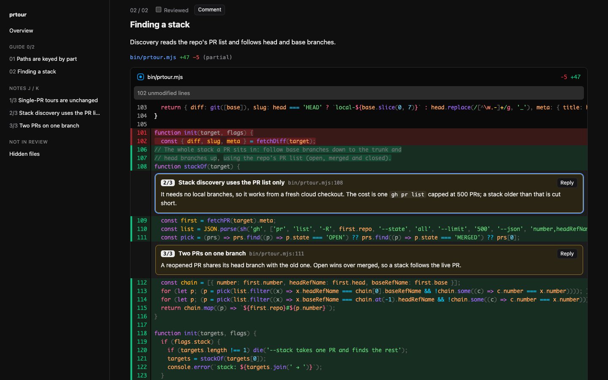
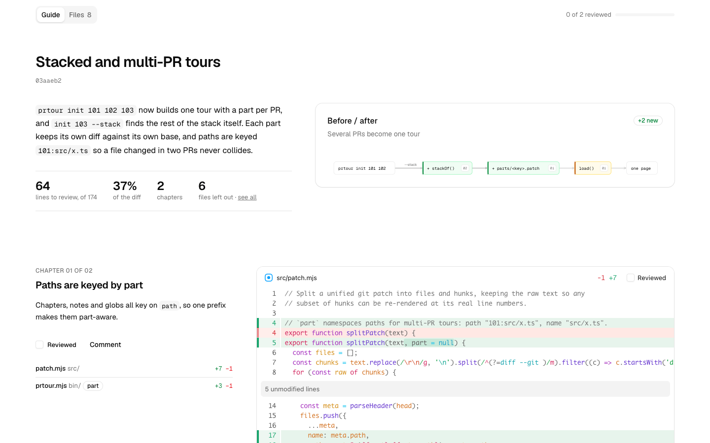

<h1 align="center">prtour</h1>
<p align="center">Guided PR reviews and recaps, written by your coding agent.</p>
<p align="center">
  <a href="#run-it">Get started</a> ·
  <a href="#with-an-agent">With an agent</a> ·
  <a href="#recaps">Recaps</a> ·
  <a href="#commands">Commands</a>
</p>

prtour turns a diff into a guided review. Your agent reorders the diff into
chapters by idea and puts numbered notes on the lines that matter. Tests,
generated files and helper noise are hidden but still listed, so a 2,000-line
PR becomes the 400 lines a maintainer needs to read. Pointed at weeks of
merged PRs instead, it writes a recap of what got fixed, what is new and what
got better.



One `tour.json` renders four ways:

- **HTML**: one self-contained file. Diffs are pre-rendered with
  [@pierre/diffs](https://diffs.com), so the file needs no server and works as
  an artifact, an attachment, a static page or a `file://` URL.
- **Markdown**: for a PR comment, Slack or chat.
- **Terminal**: `prtour show`, colored and paged. Diagrams draw as text, and
  screenshots show inline in kitty, Ghostty, WezTerm and iTerm2.
- **PDF**: `prtour render --format pdf`, through headless Chrome.

## Run it

Not on npm yet; run it straight from GitHub (`npx -y github:2018kguo/prtour …`)
or `npm i -g github:2018kguo/prtour` and use `prtour`.

```sh
npx prtour 123          # PR in this repo → scaffold → opens in the browser
npx prtour              # this branch (incl. uncommitted) vs. the default branch
npx prtour 101 102 103  # several PRs as one tour, one part per PR
npx prtour 103 --stack  # the whole stack 103 sits in, found via base/head branches
```

## With an agent

**Claude Code**, as a plugin:

```
/plugin marketplace add 2018kguo/prtour
/plugin install prtour@prtour
```

**Any agent with skills** (Claude Code, Codex, Cursor and others), through
[skills](https://github.com/vercel-labs/skills):

```sh
npx skills add 2018kguo/prtour
```

**Without installing anything**, the instructions ship with the tool:

```sh
npx -y github:2018kguo/prtour skill             # print them (pipe into any agent)
npx -y github:2018kguo/prtour skill --install   # write .claude/skills/prtour/SKILL.md
```

Or add one line to `AGENTS.md` / `CLAUDE.md`. This works for cloud agents too,
since all they need is `npx`:

```md
For a guided review of a diff, run `npx -y github:2018kguo/prtour skill` and follow it.
```

Then ask: *"open this PR in prtour"*, *"make a guided review of #123 and attach
it"*, *"walk me through this branch"*.

The agent:

1. Runs `prtour init <pr|range>`. This fetches the diff with `gh` or `git` and
   scaffolds `.prtour/<slug>/tour.json`, with lockfiles, generated files and
   tests already hidden.
2. Writes the tour: chapters in reading order, `1/N` notes anchored to lines,
   and hides whatever doesn't need review, down to single hunks in a mixed file.
   `prtour hunks <file> --lines` prints the hunk indices and line numbers it
   needs.
3. Runs `prtour check` until it is clean. Every file must be placed, and every
   note must point at a line that is shown.
4. Delivers the result:
   - **Locally**: `prtour open` serves the page with live reload. You comment
     on any line, note or chapter, the comments go to `feedback.json`, and the
     agent reads them with `prtour feedback`.
   - **Cloud agents**: `prtour render -o review.html` (attach it) and
     `prtour render --format md` (post it).

## What the page does



- Overview: the summary, the flow of the change, the reading order of notes,
  and what was left out and why.
- Chapters, each with a "Reviewed" checkbox (remembered per browser) and
  progress shown in the sidebar.
- `j` / `k` move between notes.
- Click any line number to comment on it. The comments are sent to the agent
  under `prtour open`; otherwise **Copy feedback** puts them on the clipboard
  as Markdown.
- "Not in review" holds every hidden file and hunk, collapsed, so nothing
  skips review by accident.
- Stacks get a Stack list in the overview, with per-PR stats, and `#101`
  badges on every file and note. Each PR's diff is against its own base, so
  the same file changed in two PRs appears once per PR.
- Light and dark mode follow the system.

## Recaps

```sh
prtour recap --author you,teammate --since 2026-10-27 --until 2026-11-03
```

This gathers every PR the authors merged in that window into `recap.json`,
with one context file per PR. A context file holds the description, the
largest files, and what the person asked the agent that opened the PR. That
last part is read from local Claude Code and Codex transcripts and never
leaves your machine; pass `--no-lanes` to skip it.

The agent groups the PRs into workstreams of three kinds: fixes, new
features worth a demo, and improvements. Each leads with what people lived
through and how bad it was, explains the cause in plain words, and shows the
result. The tools are a Before/After timeline with a play button, a chart of
real measurements with deploys marked, and a few lines of the diff that
carry the idea. Engineering detail is folded away. `prtour check` holds the
writing to plain, sourced, newspaper-style prose. The recap renders as HTML,
a compact PDF, Markdown for Slack or GitHub, or in the terminal.

## Design

Components come from [Basecoat](https://basecoatui.com), which is shadcn/ui
in plain HTML and CSS, so pages need no build step and stay one file. Type is
Geist for reviews and IBM Plex for recaps. Icons are [Lucide](https://lucide.dev)
and [SVGL](https://svgl.app). Diffs are [@pierre/diffs](https://diffs.com).

## Commands

```
prtour [target…]           init + open in the browser
prtour init [target…]      fetch the diff, scaffold .prtour/<slug>/tour.json (--stack, --dir)
prtour hunks [file…]       list hunk indices; --lines adds old/new line numbers
prtour check [dir]         validate tour.json against the diff (exit 1 on warnings)
prtour render [dir]        self-contained HTML (-o file; --format md|term|pdf; --split; --wrap)
prtour show [dir]          terminal view
prtour open [dir]          live-reload server + reviewer feedback
prtour feedback [dir]      reviewer comments as Markdown (--clear)
prtour recap               what shipped across many PRs (--author, --since, --until, --repo, --no-lanes)
prtour skill [--install]   agent instructions

target: 123 | https://github.com/o/r/pull/123 | o/r#123 | main...HEAD | file.patch | -
```

PRs need [`gh`](https://cli.github.com) to be signed in. Ranges and the current
branch only need `git`. Node 20 or newer.

The `tour.json` and `recap.json` schemas are in
[skills/prtour/SKILL.md](./skills/prtour/SKILL.md).

## Credits

The idea comes from [@d0xxed's "hide the non-core edits" hunk
reviews](https://x.com/d0xxed/status/2117672152724083113) and [Capy's Guided
Reviews](https://x.com/0xluffy/status/2107593041519501477). Diff rendering is
[@pierre/diffs](https://diffs.com).

## License

MIT
